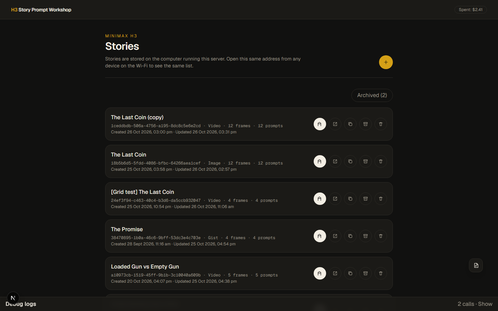
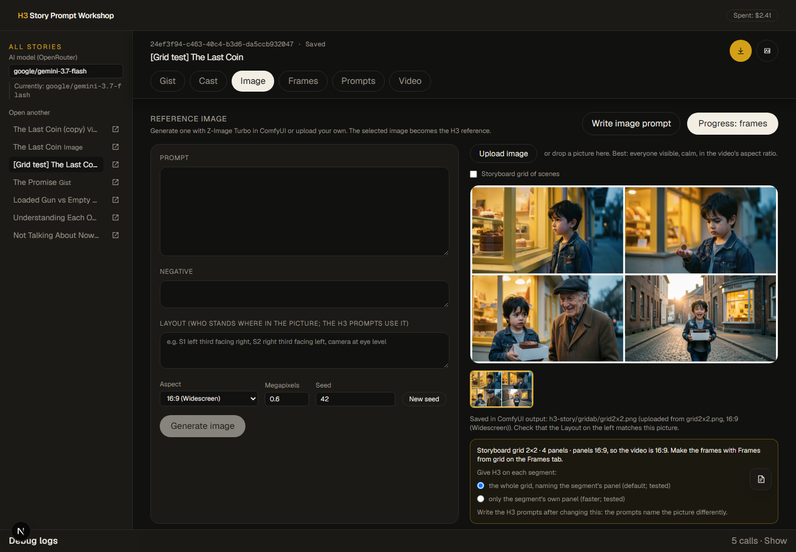
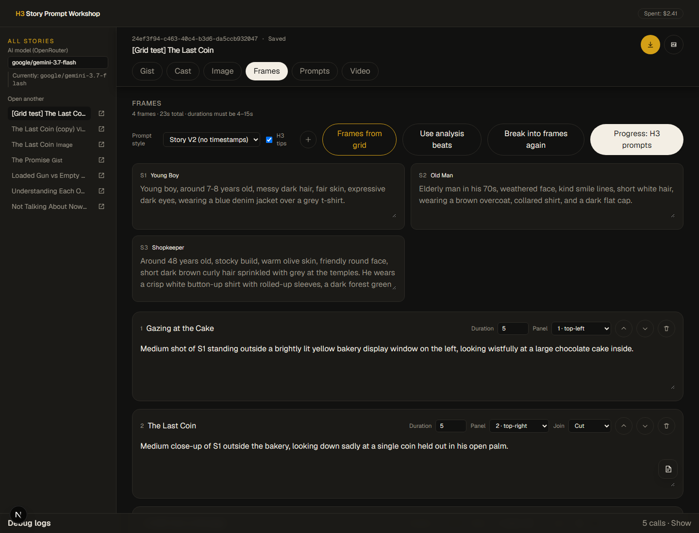
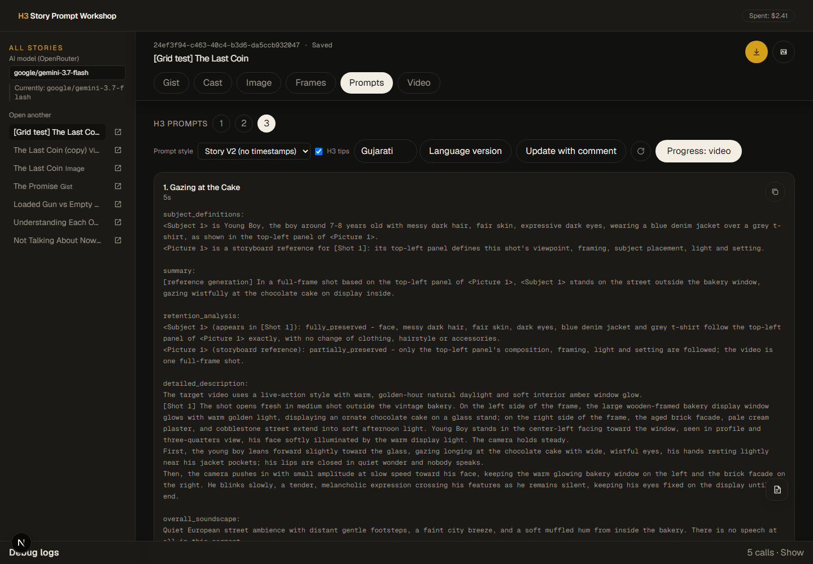
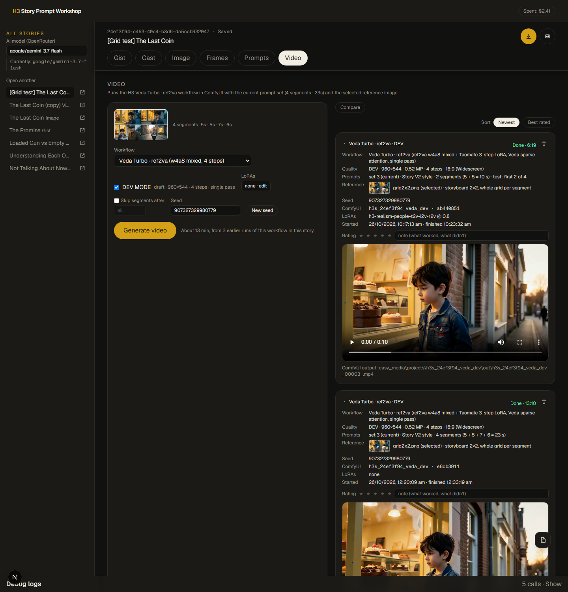
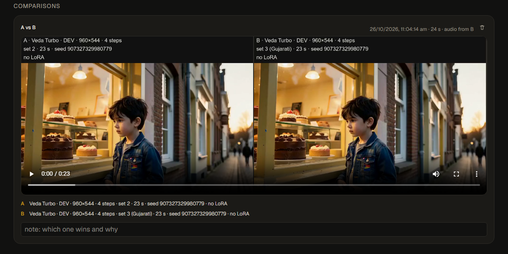

# H3 Story Prompt Workshop

Local workshop for turning a story gist into MiniMax H3 prompts and rendering them as videos in ComfyUI.

## What it looks like

| | |
|---|---|
|  |  |
| **Stories**: every story with its step, frames, prompts and dates; open, duplicate, archive or delete. | **Image**: generate a reference with Z-Image Turbo or upload one, here a 2x2 storyboard grid. |
|  |  |
| **Frames**: one frame per panel, with panel and cut/continue join; prompt style and H3 tips. | **Prompts**: paste-ready H3 prompts, prompt sets (1, 2, 3 = Gujarati), language versions and updates. |
|  |  |
| **Video**: workflow, DEV/FULL, LoRAs, test with the first N segments, and every generation with its details. | **Comparisons**: generations stitched side by side with their settings, here English vs Gujarati. |


Stories are saved as JSON files under `data/stories/` on this machine. Each story has its own URL with an id and step:

```text
/stories/<id>/gist
/stories/<id>/cast
/stories/<id>/image
/stories/<id>/frames
/stories/<id>/prompts
/stories/<id>/export
/stories/<id>/video
```

Open one story, or open several in new tabs. The home page lists all of them.

1. Create a story and paste a gist.
2. **Progress: cast & location** extracts the characters and the main location (invented if the gist has none). Both are editable.
3. **Progress: reference image prompt** writes a Z-Image Turbo prompt for one still that shows every character in the location.
4. **Generate image** runs `comfy/z-image-turbo-t2i.json` in ComfyUI. Keep generating with new seeds and select the best one; it becomes the H3 reference image (`ComfyUI/output/h3-story/<id>/`).
5. **Progress: frames** breaks the story into editable clips (4–15s each), keeping the cast and location locked.
6. **Progress: H3 prompts** writes one paste-ready prompt per frame.
7. **Export** downloads `{ duration, prompt }` JSON for the other device.
8. **Export** (step) writes the video file, see [Video files](#video-files-export-and-import).
9. **Video** renders the prompt set with the selected reference image in ComfyUI. Pick a workflow:
   - **Veda Turbo** (default for new stories, `comfy/h3-story-veda-turbo.json`) and **Sage SLA** (`comfy/h3-story-sage-sla.json`): the fast "Story Speed Tests" workflows from ComfyUI (`user/default/workflows/MiniMax H3/Story Speed Tests`), converted to API format with ComfyUI's own frontend. Both use the ref2va w4a8 mixed model in a single pass, every segment a `ref` task (`ref_image_size: max`). Veda Turbo: Taomate 3-step LoRA, Veda sparse attention, 4 steps. **Singularity Veda** (`comfy/h3-story-singularity-veda.json`, same layout): the Singularity v2 ref2va w4a8 fine-tune with the Taomate 3-step LoRA and Veda sparse attention, 3 steps; project folders `h3s_<id>_sveda[_dev]`. Sage SLA: ref2v turbo 8-step LoRA, Sage + H3 SLA 0.85, 10 steps. DEV renders 544×960 (FULL 768×1344) for 9:16, 960×544 (1344×768) for 16:9, and a custom size with the same pixel count for other ratios. Project folders `h3s_<id>_veda[_dev]` / `h3s_<id>_sage[_dev]`. The time estimate comes from earlier finished runs of the same workflow in the story. If you change the ComfyUI files, re-export them to `comfy/` (same node ids).
   - **Long take** (`comfy/h3-long-take-ref.json`): fl2va model, single pass, RTX VSR. DEV = draft, off = final.
   - **Story V2** (`comfy/h3-story-v2-ref2va.json`, from the Themed Transformation Pipeline): ref2va model, every segment a `ref` task on the same image, dual pass with a x1.25 latent-upscale refine. DEV and FULL each have their own megapixels / steps (default 0.3 MP / 10 steps) and project folder (`h3s_<id>_v2_dev` / `h3s_<id>_v2`). Proven with segments of 8 s or less; the Workshop's timestamped prompts are not yet tested with it. Details: `docs/HANDOFF_h3_story_v2_for_workshop_app.md`.

Image generation needs ComfyUI running with the Z-Image Turbo models from the template. Set `COMFYUI_URL` in `.env.local` if ComfyUI is not at `http://127.0.0.1:8188`.

Set `COMFYUI_OUTPUT_DIR` in `.env.local` to ComfyUI's output folder when the app runs on the same machine: images and videos are then served straight from disk. ComfyUI's own file serving can stall, and videos then spin forever in the player.

On the Image tab you can also **upload your own picture** (Upload image, or drop a file on the image area). The browser converts it to PNG (scaled down to at most 4 MP) and the app stores it in ComfyUI's output folder next to the generated ones (`h3-story/<story id>/upload_<time>.png`), so both video workflows use it the same way. Its aspect ratio is matched to the nearest supported one. The **Layout** box under the prompt (who stands where) feeds the H3 prompts: edit it to match an uploaded picture.

### Projects

Stories belong to projects. The story list shows the projects at the top (with how many stories each has); click one to
see its stories below. *+ New project* makes one, *Rename* renames the open one, and *Move to…* on a story moves it to another project (with
everything it has: prompts, videos, comparisons, cost). New stories and imported video files go
into the open project, and a duplicate stays in its story's project. Stories made before projects existed are in
**unknown**, which can be renamed too. The list remembers the last project you opened (`/?project=<id>` opens one
directly). On a story's page the sidebar lists only that project's stories, and its top link goes back to the project.
Under each story title (in the list, on the story page and in its sidebar) is the AI model that writes the story's text; the list and the sidebar also show each story's AI cost
(google/gemini-3.7-flash), with "(default)" when the story uses the .env default. Each story in the list shows its
latest finished video on the right, ready to play (with picture in picture). Projects are kept in `data/projects.json`.

### Story types

Pick the type next to the New story button (type-1 is preselected); it is set when the story is created and shown in the list (*type-1*).

- **regular**: every step, as described above.
- **type-1**: no Cast step, so the Gist step goes straight to the reference image, and *Write image prompt* and the frames
  work from the gist. A title you type by hand is kept (AI steps may still set it until you do). *Frames from grid* is
  hidden, and so is the note that Story V2 is proven only up to 8 s. A duplicate or an imported video file keeps the type.

### Video files (export and import)

Rendering can be split in two: export what a video needs into one file, then import that file to see the details and
generate.

- **Export** step: *Export video file* downloads `<story>.video-package.json` with the current prompt set, the video
  settings (workflow, DEV/FULL, seed, LoRAs, segment limit, grid feed), the gist, cast and location, and the reference
  image embedded as a PNG (with its panels for a storyboard grid). A grid story makes a file of about 20 MB.
- **Import video file** (story list, Export step or Video step): needs ComfyUI running, since the images are stored in its
  output folder (`h3-story/<new id>/`). It creates a new story marked *Imported* and opens it. Nothing renders yet.
- An imported story only has the **Video** step: the details from the file on top (segments open to show their prompts),
  then the usual settings, *Generate video*, generations, rating and comparisons. Settings can be changed before
  generating; the file stays as it was. LoRAs must exist in that ComfyUI, otherwise Generate names the missing one.
- A normal story's Video step still generates directly, without a file.

The format (`lib/video-package.ts`, `format: "h3-video-package"`, `version: 1`) is ready for merging files later: `sources`
and `images` are lists, and every segment names its own `image` and `source`, so a merged file is the segments of several
files in order, with all their images and sources. Importing a file whose segments use more than one image is refused for
now, because a run takes a single reference image.

### Testing, LoRAs and rating (Video tab)

- **FULL size follows the longest segment**: picture size x clip length has to fit in the GPU's 16 GB. Past that H3 spills
  into system RAM and sampling stalls (1344×768 with a 15 s clip made no progress in 21 minutes, 1152×640 sampled it in 4.5
  minutes). So the fast workflows shrink FULL to fit the story's longest segment and say so on the Video tab: 15 s gives
  1152×640 at 16:9, while segments of about 10 s keep 1344×768. DEV and Ultra fast are small enough already.
- **Ultra fast** (next to DEV MODE, fast workflows only): for checking that a story works before a real render. It uses a
  small canvas (256×448 at 9:16, about a fifth of DEV's pixels) and Sage SLA runs 6 steps instead of 10 (Veda Turbo
  stays at 4 and Singularity Veda at 3). Expect a rough picture and weaker lip-sync. Files go to the project folder
  `h3s_<id>_<tag>_ultra`, and the run is marked ULTRA FAST.
- **Duplicate** (copy icon in the story list) makes a copy named "… (copy)" with everything except the generated
  videos and comparisons: gist, analysis, cast, reference images, frames, all prompt sets and the video settings.
- **Queue several videos**: *Generate video* stays available while others render (*Queue another video*); ComfyUI
  runs them one after another and each card shows its own place in the queue and progress. A queued video's timer and
  progress bar stay at zero until its turn comes; the time shown (and the time estimates) count from when it started.
- **When done**: *Play a sound when done* is a setting saved with the story: every video queued while it is ticked plays
  `public/notify-2.mp3` when it ends, unless you cancelled it. Changing the tick does not affect videos already queued. *Hibernate this machine when done* then starts a
  60 s countdown with a Cancel button at the top of the page, and hibernates the computer running the app once ComfyUI has
  no jobs left, including jobs from other stories. It is used once and never saved, so tick it for each render. Keep the
  page open: the browser tab runs both, and a background tab can add up to a minute.
- **Skip segments after N**: tick it and set N to render only the first N segments of the prompt set, to try a look
  before rendering a long story. The run's details say "test: first N of M".
- **LoRAs · edit** opens the enhancement-LoRA popup. It lists what ComfyUI has in `models/loras/minimax-h3`, scanned
  fresh every time it opens (new files show up without a restart). Tick a LoRA and set its strength (-2..2); speed
  LoRAs are marked and hidden by default (*Hide speed LoRAs*; an enabled one stays visible), since the fast
  workflows already carry their own. Enabled LoRAs are chained right after the
  workflow's model loader (`LoraLoaderModelOnly`), in list order, for every workflow; the server rejects names ComfyUI
  does not know. Each run's details list the LoRAs and strengths it used.
- **Rating**: give each finished video 1-5 stars (click the same star again to clear) and a short note; **Best rated**
  sorts the list by stars. Rated videos collapse to a one-line summary (stars and note stay visible); the ▸ / ▾
  title button expands or collapses any card, and that choice is kept.
- **Compare**: press *Compare*, tick 2-4 finished videos (they become A, B, C, D in pick order), choose whose audio to
  keep and press *Create comparison*. ffmpeg stitches them side by side (2x2 for four), each under a header with its
  workflow, quality, prompt set, length, seed and LoRAs; shorter clips hold their last frame. Comparisons get their own
  section with the video, the full info of each side (with its stars and note), a note box and a delete button that
  also removes the file. Files: `data/comparisons/<story id>/<id>.mp4`. With `COMFYUI_OUTPUT_DIR` in `.env.local` the
  videos are read straight from ComfyUI's output folder (seconds instead of a minute through ComfyUI's /view).
- **Picture in picture**: the button under a generation or comparison video plays it in a small floating window that stays
  on top while you scroll, switch browser tabs or use another app (*Back to page* returns it, at the point it reached). Chrome,
  Brave and Edge open it as a window of its own; elsewhere the video's own picture-in-picture is used, and Firefox does not show it.
- **Full-screen view**: click a generation's reference thumbnail (or the big image on the Image tab) to open it full
  screen; ← / → step through the story's images and a storyboard grid's panels, Esc or a click outside closes.
- **Delete** (bin icon on a finished, failed or cancelled video) removes it from the story after a confirmation; the
  video file stays in ComfyUI's output folder (ComfyUI has no delete call).

### Approving AI frames

After *Break into frames* or *Frames from grid*, the Frames step shows a reminder: the AI wrote these frames and nobody
has changed them yet, so read them through. Until you press **Approve frames** (or edit, add, move, remove or split a frame,
which counts as a review), the Frames tab blinks amber on every step, and moving on to the prompts asks whether you are sure
no changes are required (yes approves them).

### Splitting a frame

On the Frames step every frame has a **Split** button: choose *Auto* (the AI picks 2 to 4) or 2, 3 or 4 frames. The AI
divides the action at natural moments and puts each spoken line, word for word and in order, into exactly one of the new
frames; the app checks that and asks once more if a line went missing. Each new frame gets a length that fits its lines.
The first part keeps the frame's panel and join, the others continue it. Like any frame edit it clears the current prompts
(earlier prompt sets stay), so write the prompts again afterwards.

### What changed between prompt sets

Each generation's *Prompts* row and the Prompts tab show a link like *vs set 5: 3 added · 2 removed · 4 updated*, comparing the
set with the one before it. Click it for a side-by-side view, segment by segment, with the changed words highlighted and
unchanged lines folded away (*Show unchanged lines* brings them back). Lines are compared by text, with no AI involved.

### Dialogue view

On the Prompts tab, tick **Dialogue view** to see only the spoken lines of the current prompt set, segment by segment:
who says what, or *No dialogue*. Nothing is sent to the AI: the lines are read from the `<d>` tags in the prompts
(`lib/dialogue.ts`). Times are estimates at 2.2 words per second. Long-take prompts also show the start and end times they
give the line; a line and its segment turn amber when the line, spoken from its start, runs past the end of the clip, which
is what gets cut off in the video. Prompts without times (Story V2) turn amber when the words need longer than the segment
(speech plus about 2.5 s of silence). Each line has a checkbox for internal debugging, and **Hide unselected** narrows the view to
the ticked lines; ticks are not saved and clear on reload.

Long lines get the time they need, at three points. Frames are lengthened to fit the quoted lines in their summary (up to
15 s) when they are created and again when prompts are written, so an edited frame counts too. After writing, a long-take
prompt with a line that would run past the end of the clip is sent back to the AI once to re-time it. For prompts already
written, **Fix timing** in Dialogue view makes a new prompt set: tight segments get longer and their lines are re-timed by
the AI (Story V2 prompts have no times, so only the length changes). If a segment's words need more than 15 s it stays
amber: split that frame on the Frames step.

On long-take prompts every line also has a seconds box (it shows the current slot). Type a value and press **Update in
prompts** to make a new prompt set, with no AI: the line keeps its start, everything after it moves, and the segment length
follows (up to 15 s, or an error if it no longer fits). H3 does not follow timestamps exactly, so listen to the result.

### Who speaks on screen

H3 moves the mouth of whoever is on screen, whatever the prompt's labels say, so a line spoken over the other person comes
out of the wrong mouth. Cuts between speakers cause this, and so do off-screen lines and a segment opening on a different
framing than the previous one ended on. Prompts therefore keep a conversation in one continuous two-shot with every
speaker in frame, and a prompt that breaks this is sent back to the AI once. Dialogue view marks older prompts with a
*Wrong-speaker risk* note: write the prompts again to fix them.

### Dialogue in another language

On the Prompts tab, type a language (Gujarati, Hindi, ...) and press **Language version**: the app copies the current
prompt set and translates only the spoken lines (`<d>[Language] ...</d>`), in the language's own script, keeping their
length and emotion. Everything else (shots, camera, panels, looks) stays identical, so rendering it with the same seed
gives the same film in the other language. The new set is marked with its language on its set button.

### Storyboard grids

A reference picture can be a **storyboard grid** of scenes. Tick *Storyboard grid of scenes* and set rows x columns before
uploading (the last rows x columns used in this browser come back next time): the browser also cuts the panels out (trimming white gutters) and the panel aspect ratio becomes the video's.
Use clean panels without captions or numbers, the same characters in every panel. Then:

- **+ next to a frame's Panel** gives the frame the next panel (after its own, or after the previous frame's when it has
  none) and fills that panel into the following frames that have none, up to the first frame whose panel you chose
  yourself; panels filled this way follow a later **+** on an earlier frame. With *+ switches the frame to a Cut when it
  moves to a later panel* ticked (the default, remembered in this browser), that frame's join becomes **Cut** when its
  panel is later than the previous frame's; the following frames keep their joins.
- **Frames > Frames from grid** sends the picture to the story's AI model (needs one that can see images, e.g.
  `google/gemini-3.7-flash`) and writes one frame per panel (reading order), each with its panel and a *Cut* join, and
  updates the character looks to what the panels show. Panel and join can be changed per frame.
- **Image tab**: choose what H3 gets on each segment: the **whole grid**, naming the segment's panel (default), or **only
  the segment's own panel** (faster; the default for new type-1 stories). Both were tested on Veda Turbo: H3 opens each segment on the right panel with no grid
  borders in the video (`docs/RESEARCH_grid_reference_image.md`, section 6).
- **Prompts** name `<Picture 1>` as the storyboard reference for the segment's panel; cut segments start fresh (no
  continuation opener or +0.92 s timing).
- **Video**: every cut is a fresh shot (`continuity_mode: shot`), the reference keeps its detail (`ref_image_size: max`),
  and grids need a ref2va workflow (Veda Turbo, Sage SLA, Story V2), not the long take.

### AI cost per story

Under the story title: *AI cost ₹4.20 $0.042*, what that story's AI calls have cost so far, as OpenRouter reports each
call (backup and retry calls included). Pages of a story send its id with every request, and the server adds each call's
cost to `data/story-costs/<id>.json`. Counting started on 3 Nov 2026, so older calls are missing; hover for the number of
calls. A duplicate starts at zero, and deleting a story deletes its count. Amounts show rupees first (green), with
the dollars small and dim after them, at a fixed 1 USD = 100 INR (`lib/money.ts`); the model list, which cannot be
styled, reads ₹75 ($0.75).

### Spend badge

The top bar shows `Spent: $X.XX` (plus ` / $LIMIT` when the key has a limit): the total spend of the OpenRouter key, read from OpenRouter's `GET /api/v1/auth/key` by the server route `/api/openrouter-usage`. Only `usage` and `limit` reach the browser, never the key. The server caches a good answer for 60 s; the badge refreshes every minute while the tab is visible and stays hidden on any failure. It counts every project that uses the same key.

### Fixed header

The top bar (`components/top-bar.tsx`) stays fixed while scrolling; its height is `--nav-h` in `app/globals.css`, used for the content's top padding and for the story page's pinned block (title row + step tabs) right under it. Keep their ancestors free of `overflow: hidden/auto`, or sticky stops working.

## Setup

Install Node.js and npm, then from PowerShell run:

```powershell
Copy-Item .env.example .env.local
```

Add your OpenRouter key to `.env.local` to enable story breakdown and prompt generation. Then start the app:

```powershell
.\start.ps1
```

The launcher installs dependencies when needed and frees port `38217` if it is already in use. Open the local app at:

```text
http://localhost:38217
```

The app binds to `0.0.0.0:38217`, so another machine on the same Wi-Fi can open:

```text
http://<this-computer-lan-ip>:38217
```

On Windows, find the PC's LAN address with `ipconfig`. Open that URL on the other machine. Do not start a second copy of the app there, or you will see an empty story list. If the other machine cannot connect, allow Node.js through Windows Defender Firewall on private networks.

Default model: `deepseek/deepseek-v4-flash-0731` (`OPENROUTER_MODEL` in `.env.local`, may be a comma-separated fallback chain).

### Choosing the AI model

Each story has an **AI model (OpenRouter)** field at the top of the left sidebar, used by every AI step of that story (analysis, cast, image prompt, frames, H3 prompts and updates). It is free text with a suggestion list (`lib/models.ts`): pick one, type any OpenRouter id, or comma-separate up to three ids as a fallback chain (more are cut to three). New stories start with `google/gemini-3.7-flash`, the recommended choice (fast, about a cent per call; the Use recommended link fills it back in). Blank means the `.env` default (older stories without the field also use it). The note under the field shows the model that will be used and turns amber for free/basic models. The server validates the ids (`provider/model`) and answers 400 for anything else; the dev-server log shows which model actually answered when it was a fallback. Prices in the list are approximate.

## Skills in this repo

- `skills/minimax-h3-prompt-agentskill/` — copy of [benjiyaya/Minimax-H3-Prompt-AgentSkill](https://github.com/benjiyaya/Minimax-H3-Prompt-AgentSkill)
- `skills/h3-prompt-writing/` — official MiniMax H3 prompt-writing skill
- `prompts/` — compiled system prompts used by the app
