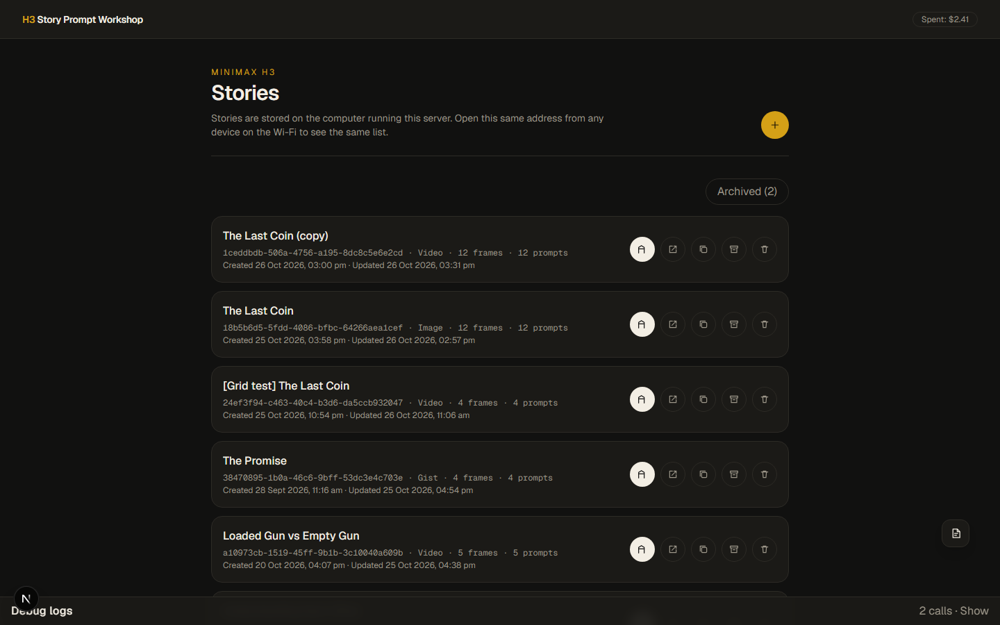
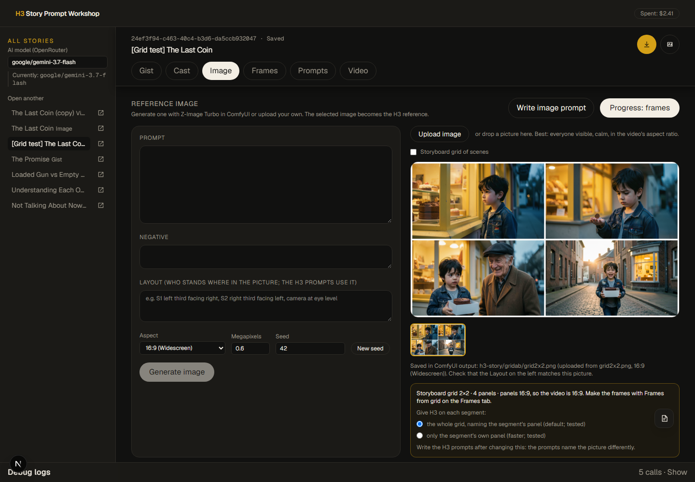
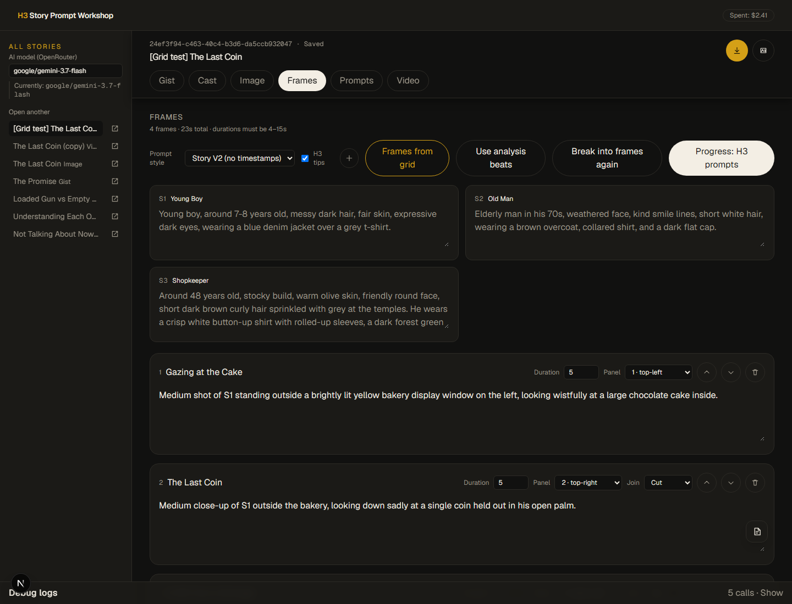
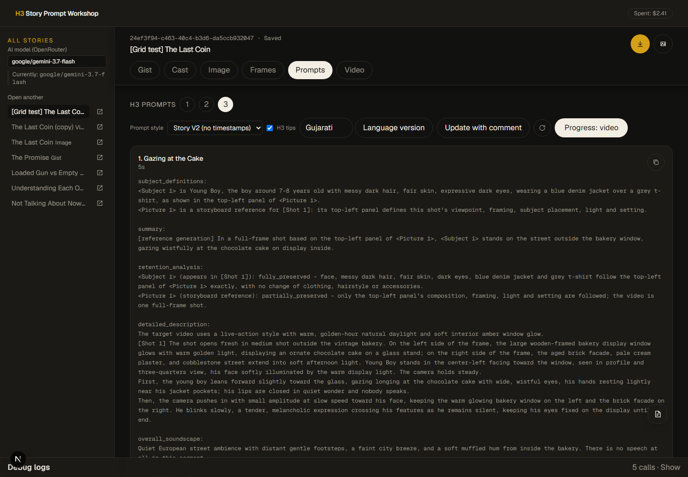
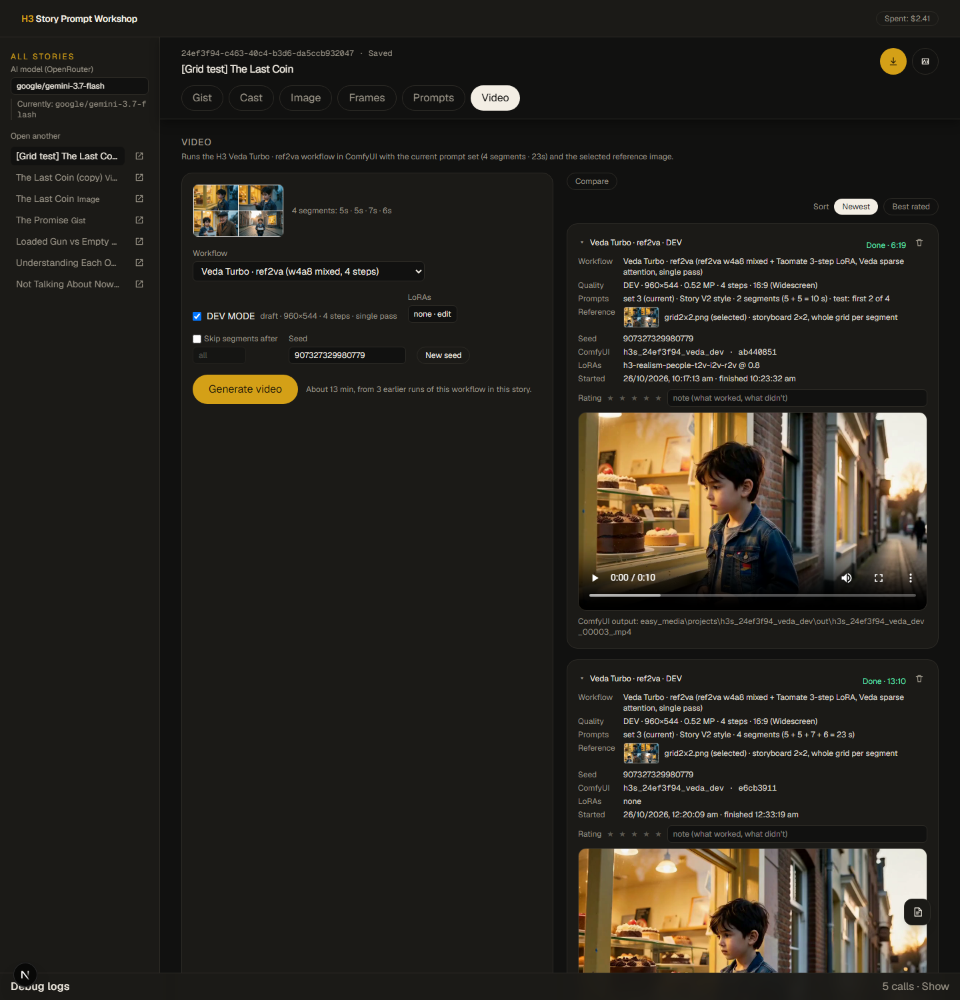
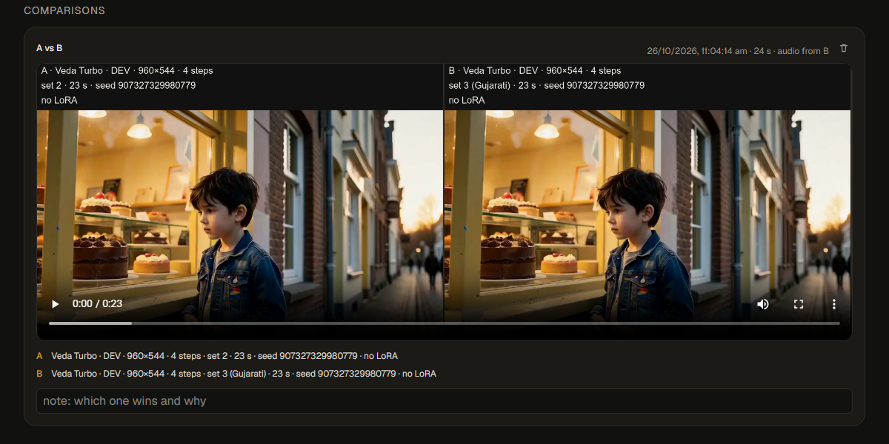

# H3 Story Prompt Workshop

Local workshop for turning a story gist into MiniMax H3 prompts and rendering them as videos in ComfyUI.

## What it looks like

| | |
|---|---|
|  |  |
| **Stories**: every story with its step, frames, prompts and dates; open, duplicate, archive or delete. | **Image**: generate a reference with Z-Image Turbo or upload one, here a 2x2 storyboard grid. |
|  |  |
| **Frames**: one frame per panel, with panel and cut/continue join; prompt style and H3 tips. | **Prompts**: paste-ready H3 prompts, prompt sets (1, 2, 3 = Gujarati), language versions and updates. |
|  |  |
| **Video**: workflow, DEV/FULL, LoRAs, test with a range of segments (e.g. 3-6), and every generation with its details. | **Comparisons**: generations stitched side by side with their settings, here English vs Gujarati. |


Stories are saved as JSON files under `data/stories/` on this machine. Each story has its own URL with an id and step:

```text
/stories/<id>/gist
/stories/<id>/cast
/stories/<id>/image
/stories/<id>/frames
/stories/<id>/prompts
/stories/<id>/export
/stories/<id>/video
```

Open one story, or open several in new tabs. The home page lists all of them.

1. Create a story and paste a gist.
2. **Progress: cast & location** extracts the characters and the main location (invented if the gist has none). Both are editable.
3. **Progress: reference image prompt** writes a Z-Image Turbo prompt for one still that shows every character in the location.
4. **Generate image** runs `comfy/z-image-turbo-t2i.json` in ComfyUI. Keep generating with new seeds and select the best one; it becomes the H3 reference image (`ComfyUI/output/h3-story/<id>/`). The Generate image box (prompt, negative, layout, aspect, megapixels, seed) starts closed, showing one line with its settings and the start of the prompt; click it to open. Write image prompt opens it to show what was written.
5. **Progress: frames** breaks the story into editable clips (4–11 s each), keeping the cast and location locked. New frames (from the AI, from beats, Split or a storyboard grid) are planned at most 11 s (`MAX_FRAME_SECONDS` in `lib/dialogue.ts`): longer clips cost much more time and GPU memory, and H3 stretches speech to fill the clip anyway. A frame or prompt can still be set up to 15 s by hand.
6. **Progress: H3 prompts** writes one paste-ready prompt per frame.
7. **Export** downloads `{ duration, prompt }` JSON for the other device.
8. **Export** (step) writes the video file, see [Video files](#video-files-export-and-import).
9. **Video** renders the prompt set with the selected reference image in ComfyUI. Pick a workflow:
   - **Veda Turbo** (default for new stories, `comfy/h3-story-veda-turbo.json`) and **Sage SLA** (`comfy/h3-story-sage-sla.json`): the fast "Story Speed Tests" workflows from ComfyUI (`user/default/workflows/MiniMax H3/Story Speed Tests`), converted to API format with ComfyUI's own frontend. Both use the ref2va w4a8 mixed model in a single pass, every segment a `ref` task (`ref_image_size: max`). Veda Turbo: Taomate 3-step LoRA, Veda sparse attention, 4 steps. **Singularity Veda** (`comfy/h3-story-singularity-veda.json`, same layout): the Singularity v2 ref2va w4a8 fine-tune with the Taomate 3-step LoRA and Veda sparse attention, 3 steps; project folders `h3s_<id>_sveda[_dev]`. Sage SLA: ref2v turbo 8-step LoRA, Sage + H3 SLA 0.85, 10 steps. DEV renders 544×960 (FULL 768×1344) for 9:16, 960×544 (1344×768) for 16:9, and a custom size with the same pixel count for other ratios. Project folders `h3s_<id>_veda[_dev]` / `h3s_<id>_sage[_dev]`. The time estimate comes from earlier finished runs of the same workflow in the story. If you change the ComfyUI files, re-export them to `comfy/` (same node ids).
   - **Long take** (`comfy/h3-long-take-ref.json`): fl2va model, single pass, RTX VSR. DEV = draft, off = final.
   - **Story V2** (`comfy/h3-story-v2-ref2va.json`, from the Themed Transformation Pipeline): ref2va model, every segment a `ref` task on the same image, dual pass with a x1.25 latent-upscale refine. DEV and FULL each have their own megapixels / steps (default 0.3 MP / 10 steps) and project folder (`h3s_<id>_v2_dev` / `h3s_<id>_v2`). Proven with segments of 8 s or less; the Workshop's timestamped prompts are not yet tested with it. Details: `docs/HANDOFF_h3_story_v2_for_workshop_app.md`.

Image generation needs ComfyUI running with the Z-Image Turbo models from the template. Set `COMFYUI_URL` in `.env.local` if ComfyUI is not at `http://127.0.0.1:8188`.

Set `COMFYUI_OUTPUT_DIR` in `.env.local` to ComfyUI's output folder when the app runs on the same machine: images and videos are then served straight from disk. ComfyUI's own file serving can stall, and videos then spin forever in the player.

On the Image tab you can also **upload your own picture** (Upload image, or drop a file on the image area). The browser converts it to PNG (scaled down to at most 4 MP) and the app stores it in ComfyUI's output folder next to the generated ones (`h3-story/<story id>/upload_<time>.png`), so both video workflows use it the same way. Its aspect ratio is matched to the nearest supported one. The **Layout** box under the prompt (who stands where) feeds the H3 prompts: edit it to match an uploaded picture.

### Projects

Stories belong to projects. The story list shows the projects at the top (with how many stories each has); click one to
see its stories below. *+ New project* makes one, *Rename* renames the open one, and *Move to…* on a story moves it to another project (with
everything it has: prompts, videos, comparisons, cost). New stories and imported video files go
into the open project, and a duplicate stays in its story's project. Stories made before projects existed are in
**unknown**, which can be renamed too. The list remembers the last project you opened (`/?project=<id>` opens one
directly). On a story's page the sidebar lists only that project's stories, and its top link goes back to the project.
The panel icon at its top hides the sidebar to a thin strip with a ← (back to the project) and the same icon to bring it back. It starts open on windows
at least 1280 px wide and hidden on narrower ones; your choice is remembered in this browser, separately for wide and
narrow windows. Narrower windows also stack the Video and Image steps' two halves.
Under each story title (in the list, on the story page and in its sidebar) is the AI model that writes the story's text; the list and the sidebar also show each story's AI cost, and the list the stars of its latest video
(google/gemini-3.7-flash), with "(default)" when the story uses the .env default. Each story in the list has a **note** box, saved automatically a moment after you stop typing ("Saved" shows under it);
saving a note does not move the story up the list, and a page with the story open cannot overwrite it. On a story's page,
hovering a story in the sidebar shows its note. Each story in the list shows its
latest finished video on the right, ready to play (with picture in picture). Projects are kept in `data/projects.json`.

### Story types

Pick the type next to the New story button (type-1 is preselected); it is set when the story is created and shown in the list (*type-1*).

- **regular**: every step, as described above.
- **type-1**: no Cast step, so the Gist step goes straight to the reference image, and *Write image prompt* and the frames
  work from the gist. A title you type by hand is kept (AI steps may still set it until you do). *Frames from grid* is
  hidden, and so is the note that Story V2 is proven only up to 8 s. A duplicate or an imported video file keeps the type.

### Video files (export and import)

Rendering can be split in two: export what a video needs into one file, then import that file to see the details and
generate.

- **Export** step: *Export video file* downloads `<story>.video-package.json` with the current prompt set, the video
  settings (workflow, DEV/FULL, seed, LoRAs, segment limit, grid feed), the gist, cast and location, and the reference
  image embedded as a PNG (with its panels for a storyboard grid). A grid story makes a file of about 20 MB.
- **Import video file** (story list, Export step or Video step): needs ComfyUI running, since the images are stored in its
  output folder (`h3-story/<new id>/`). It creates a new story marked *Imported* and opens it. Nothing renders yet.
- An imported story only has the **Video** step: the details from the file on top (segments open to show their prompts),
  then the usual settings, *Generate video*, generations, rating and comparisons. Settings can be changed before
  generating; the file stays as it was. LoRAs must exist in that ComfyUI, otherwise Generate names the missing one.
- A normal story's Video step still generates directly, without a file.

The format (`lib/video-package.ts`, `format: "h3-video-package"`, `version: 1`) is ready for merging files later: `sources`
and `images` are lists, and every segment names its own `image` and `source`, so a merged file is the segments of several
files in order, with all their images and sources. Importing a file whose segments use more than one image is refused for
now, because a run takes a single reference image.

### Testing, LoRAs and rating (Video tab)

- **FULL size follows the longest segment**: picture size x clip length has to fit in the GPU's 16 GB. Past that H3 spills
  into system RAM and sampling stalls (1344×768 with a 15 s clip made no progress in 21 minutes, 1152×640 sampled it in 4.5
  minutes). So the fast workflows shrink FULL to fit the story's longest segment and say so on the Video tab: 15 s gives
  1152×640 at 16:9, while segments of about 10 s keep 1344×768. DEV and Ultra fast are small enough already.
- **Ultra fast** (next to DEV MODE, fast workflows only): for checking that a story works before a real render. It uses a
  small canvas (256×448 at 9:16, about a fifth of DEV's pixels) and Sage SLA runs 6 steps instead of 10 (Veda Turbo
  stays at 4 and Singularity Veda at 3). Expect a rough picture and weaker lip-sync. Files go to the project folder
  `h3s_<id>_<tag>_ultra`, and the run is marked ULTRA FAST.
- **Duplicate** (copy icon in the story list) makes a copy named "… (copy)" with everything except the generated
  videos and comparisons: gist, analysis, cast, reference images, frames, all prompt sets and the video settings.
- **Queue several videos**: *Generate video* stays available while others render (*Queue another video*); ComfyUI
  runs them one after another and each card shows its own place in the queue and progress. A queued video's timer and
  progress bar stay at zero until its turn comes; the time shown (and the time estimates) count from when it started.
- **When done**: *Play a sound when done* is a setting saved with the story: every video queued while it is ticked plays
  `public/notify-2.mp3` when it ends, unless you cancelled it. Each video in progress shows both ticks again under its progress bar: change them
  there while it runs, and what happens when it ends uses the ticks as they are then (sound per video, hibernate for the
  page). *Hibernate this machine when done* then starts a
  60 s countdown with a Cancel button at the top of the page, and hibernates the computer running the app once ComfyUI has
  no jobs left, including jobs from other stories. It is used once and never saved, so tick it for each render. Keep the
  page open: the browser tab runs both, and a background tab can add up to a minute.
- **Auto-play / Auto-play in picture in picture**: settings saved with the story, copied onto each new video (and
  changeable per video while it runs). When a video with the tick is done and this story is open, the Video step opens
  and the video plays (with sound when the browser allows, else muted). With *in picture in picture* it also goes into
  the floating window and the page switches to the Prompts step, so you can read the prompts while it plays. Browsers
  only open that window right after a click or key press: then its button blinks *Click anywhere for picture in
  picture*, and the next click or key press anywhere on the page opens it (in the Claude app's browser pane it takes two).
- **Generate video box**: opens and closes with its heading (closed it shows one line: workflow, quality, segments,
  seed). It is open whenever you open the Video step, except right after the Review & save re-run.
- **Only segments**: tick it and type a range to render only those segments of the prompt set, to try a look or redo
  a part before rendering a long story: `3-6` renders segments 3 to 6, `4` only segment 4, `3-` from 3 to the end, `-4`
  the first four. The time estimate follows the range, and the run's details say "test: segments 3–6 of M" (or
  "first N of M").
- **LoRAs · edit** opens the enhancement-LoRA popup. It lists what ComfyUI has in `models/loras/minimax-h3`, scanned
  fresh every time it opens (new files show up without a restart). Tick a LoRA and set its strength (-2..2); speed
  LoRAs are marked and hidden by default (*Hide speed LoRAs*; an enabled one stays visible), since the fast
  workflows already carry their own. Enabled LoRAs are chained right after the
  workflow's model loader (`LoraLoaderModelOnly`), in list order, for every workflow; the server rejects names ComfyUI
  does not know. Each run's details list the LoRAs and strengths it used.
- **Rating**: give each finished video 1-5 stars (click the same star again to clear) and a short note; **Best rated**
  sorts the list by stars. Rated videos collapse to a one-line summary (stars and note stay visible); the ▸ / ▾
  title button expands or collapses any card, and that choice is kept.
- **Compare**: press *Compare*, tick 2-4 finished videos (they become A, B, C, D in pick order), choose whose audio to
  keep and press *Create comparison*. ffmpeg stitches them side by side (2x2 for four), each under a header with its
  workflow, quality, prompt set, length, seed and LoRAs; shorter clips hold their last frame. Comparisons get their own
  section with the video, the full info of each side (with its stars and note), a note box and a delete button that
  also removes the file. Files: `data/comparisons/<story id>/<id>.mp4`. With `COMFYUI_OUTPUT_DIR` in `.env.local` the
  videos are read straight from ComfyUI's output folder (seconds instead of a minute through ComfyUI's /view).
- **Join with another story's take** (the two-boxes button on a finished video): pick a story in the same project (it
  opens on the next story by code) and one of its finished takes (the one that runs to its last segment first, then
  the best rated, then the newest; the preview shows its end). *This story's take plays first* is ticked by default.
  ffmpeg plays the two one after the other as one video, at the first one's size (the second is fitted, with bars if
  its shape differs) and 24 fps; a take without sound gets silence. Nothing is rendered again. It is listed under
  **Joined videos** on this story's Video step with both parts, a download button, a note box and a delete button that
  also removes the file. Files: `data/joins/<story id>/<id>.mp4` (deleted with the story).
- **Smooth bridge** (ticked by default in the join window): instead of a hard cut, ComfyUI renders a short H3 clip
  between the two takes with the first/last-frame model (`minimax_h3_fl2va_pruned_w4a8_mixed` + the fl2v turbo 8-step
  LoRA at 0.85, sigma shift 12/3, euler, built in `lib/bridge.ts` from ComfyUI's core MiniMax H3 nodes; nothing in the
  story workflows changes). The first take's last 22 frames (just under a second, picture and sound) are pinned at the
  bridge's start and the second take's first 22 frames at its end (*Add Guide for MiniMax H3*); H3 fills the *New
  seconds* between (1-8, default 3). The prompt box can stay empty: it is then written from the first story's last
  frame and the second story's first frame, without their spoken lines, asking for one continuous shot. Nothing else
  to set: the bridge follows the first take. Its size, its seed, and its quality: an ULTRA FAST or DEV take gets 8
  turbo steps, a FULL take 14. The takes' own step counts cannot be copied, because the bridge runs on the
  first/last-frame model rather than the takes' reference model. The joined video appears under Joined videos at once with
  the bridge's state (queued, rendering, joining, Stop) and is made when the render ends: first take, the bridge without
  its pinned frames, second take (`/api/bridges`, `/api/bridges/status`, `/api/bridges/assemble`). The clips sent to
  ComfyUI land in its input folder (`h3bridge_<id>_from.mp4` / `_to.mp4`), renders in `output/h3-bridge/`.
  Tested (10 Nov 2026, 448×256, 8 steps, about 40 s per bridge): the seam into the bridge is seamless, motion and
  sound carry on. When the second take opens on a quite different framing, H3 still tends to cut just before the
  pinned end rather than move the camera there; ending on the second take's first frame only (`endPin: "frame"`)
  made it cut and then hold still, so the clip end is the default. The plain fl2va model with res_multistep at 15 steps
  (`quality: "full"` in `/api/bridges`, not in the window) cut at the same place and took 56 s instead of 40 s. So the
  second seam is smooth only when the second take opens close to where the first one ended. **Recipe for two smooth
  seams** (tested the same day, both seams without a cut): on the next story's Prompts step, start segment 1 from the
  first story's last frame (*Start from another story's ending*, picking the same take), render it, then join that
  take with the first one with *Smooth bridge* ticked.
- **Picture in picture**: the button under a generation or comparison video plays it in a small floating window that stays
  on top while you scroll, switch browser tabs or use another app, and the page switches to the Prompts step so you can
  read the prompts while it plays (close the floating window to stop it). Chrome,
  Brave and Edge open it as a window of its own; elsewhere the video's own picture-in-picture is used, and Firefox does not show it. For a test render (only some segments), the Prompts step scrolls to its first segment. **Generate video** /
  **Queue another video**, and the re-run from Review & save, close a floating video from before.
- **Full-screen view**: click a generation's reference thumbnail (or the big image on the Image tab) to open it full
  screen; ← / → step through the story's images and a storyboard grid's panels, Esc or a click outside closes.
- **Delete** (bin icon on a finished, failed or cancelled video) removes it from the story after a confirmation; the
  video file stays in ComfyUI's output folder (ComfyUI has no delete call).

### Spend (top right)

The top bar shows what the OpenRouter key has spent. **↺** next to it resets the shown spend to 0 (after a confirm): it
then shows *Spent since reset*, counted from that moment. OpenRouter's own total cannot be reset, so the app keeps the
key's total at the reset in `data/spend-reset.json` (delete it to go back to the full total); hover the badge for the
key's full total and when it was reset.

### Videos in progress (top bar)

Every video goes into ComfyUI's one queue, so videos queued from different stories run one after another. The top bar
shows each video in progress, from any story: `#10012 Title 2/5 · 7m` while it runs (segments done, minutes running),
`queued 1` while it waits (its place in ComfyUI's queue), and `+N other ComfyUI jobs` for jobs that are not a story's
video. Click one to open that story's Video step; the story you are on is outlined. It is checked live against ComfyUI
every 5 s while something runs (20 s when idle), so it is right even when the story's own page is closed.

### Duplicating a story

The copy button on a story in the list asks **Copy up to**: Gist (the gist and its analysis), Cast (+ characters and
location), Image (+ image prompt and reference images), Frames (+ frames), Prompts (+ prompt sets; the default, as
before) or Video (+ its generated videos). Later steps start empty, and the copy opens on the step after the last one it
kept. Settings (models, image and video settings) are always copied. Copied videos point to the same files as the
original (removing a video from a story never deletes its file); comparisons are never copied. The copy's AI cost starts
with what the kept steps cost in the original (counted per step from 5 Nov 2026).

### Story numbers

Every story has a short number, #10001 and up, shown in the story list, the story header and the sidebar (hover it for
the full id). New stories and copies get the next number; a deleted story's number is never given again (the last one
given is kept in `data/story-codes.json`). Stories made before numbers got theirs in the order they were created.

### A different AI model for Frames or Prompts

Next to the Frames and H3 prompts headings, *AI model* starts on "Story model (…)", the model chosen in the sidebar. Pick
another one there and every AI action on that step uses it (Frames: Break into frames, Frames from grid, Split; Prompts:
write, Update with comment, Fix timing, Language version); the other steps keep the story's model. The model line under the
story title then names it too: `google/gemini-3.7-flash · Frames: openai/gpt-5-mini`. Pick "Story model" again to undo.

You can also pick both before the story exists: next to *New story type* in the story list, **Frames model** and
**Prompts model** start on the defaults (Frames: the story model, google/gemini-3.7-flash; Prompts:
google/gemini-2.5-flash-lite); the new story is created with them, and the last choice is remembered in this
browser for the next new story.

Changing the Prompts model on a story that already has frames asks first:
- *Create a new story from here*: a copy with the gist, characters, images and frames (no prompts, no videos, no note),
  titled "… · <model>", in the same project, opened on its Prompts step with the new model. The story you were on stays
  as it is, so you can try several models on the same frames and compare the stories.
- *Update this story only*: just changes this story's Prompts model.

The new story's AI cost starts with what the original's Gist, Cast, Image and Frames steps cost (not its prompts),
so it shows what that model's version really cost. Costs are split by step from 5 Nov 2026; calls before that are
only in the original's total and are not carried over. Hover the AI cost in the story header to see the split.

### Model boxes and models you add

Every model box (the sidebar's, the Frames and Prompts ones, and the two next to *New story type*) is free text with a
list: pick a model (each shows its price per million tokens in ₹ and $) or type any OpenRouter id. The Frames and Prompts
boxes apply a typed model on Enter or when you leave the box; blank (or *× story model*) means the story's model. A model
that is not in the built-in list is added to every list after the first AI call with it succeeds, with its OpenRouter
price (kept in `data/custom-models.json`; delete an entry there to drop it).

### Extra instructions for the frames

At the top of the Frames step, *Extra instructions for Break into frames* takes your own instructions for the AI ("keep every
frame under 10 s", "do not add a narrator"). They are saved with the story and sent with every Break into frames (and
again); the AI follows them over its usual frame rules, but spoken lines still stay word for word.

### Approving AI frames

After *Break into frames* or *Frames from grid*, the Frames step shows a reminder: the AI wrote these frames and nobody
has changed them yet, so read them through. Until you press **Approve frames** (or edit, add, move, remove or split a frame,
which counts as a review), the Frames tab blinks amber on every step, and moving on to the prompts asks whether you are sure
no changes are required (yes approves them).

### Splitting a frame

On the Frames step every frame has a **Split** button: choose *Auto* (the AI picks 2 to 4) or 2, 3 or 4 frames. The AI
divides the action at natural moments and puts each spoken line, word for word and in order, into exactly one of the new
frames; the app checks that and asks once more if a line went missing. Each new frame gets a length that fits its lines.
The first part keeps the frame's panel and join, the others continue it. Like any frame edit it clears the current prompts
(earlier prompt sets stay), so write the prompts again afterwards.

Tick **Split the dialogue too** (off each time) when one long spoken line is what makes the frame too full: the AI may then
cut lines into pieces across the new frames, at a natural break (a sentence end, a comma, a breath), each piece quoted on
its own and said by the same speaker. The app checks that the spoken words are all still there, exactly once and in order
(punctuation at a cut may change), and asks once more if not.

### Project list

Each project is a card: its stories (and how many are archived), how many have a video, what their AI calls cost, when
one last changed, and its character list and video seed if it has them. Click a card to open the project. **Archive**
(next to Rename) folds the open project away: it moves to *Archived projects (N)*, where it can be opened or
**Unarchive**d; its stories stay as they are. "unknown" cannot be archived (new stories without a project go there).

### Project video seed

Under the project buttons, **Video seed** sets the seed new stories in the project start with (Enter or leaving the box
saves it; *New seed* picks a random one; empty = none, so new stories keep the usual default). Each story can still change
its own seed on the Video step, where **Use project seed (N)** shows when it differs. **Apply to all N stories** gives the
project's seed to every story already in it, for their next videos (videos already made keep theirs). Close the stories'
pages first: a page left open saves its own settings back.

### Project characters

Under the project buttons, **Characters of <project>** takes the project's character designs: paste them, and every
numbered heading (`### 1. ADHIYO BRAHMAN`, `1. NAME`) becomes a card whose number is its S number (S1, S2…) and whose
description is the text under it (a heading with nothing under it, like a title, is skipped; no AI). **Save N characters**
keeps the text and the cards with the project. In the project's stories, *Edit S numbers* then offers these cards.
*Copy from another project…* (shown when another project has characters) fills the box with that project's
designs, to check and save (or cancel); the two projects' lists stay separate after that.

### Character numbers (S1, S2…)

When the project has character cards, **Edit S numbers** shows a list per character with the project's cards, already
set to the card with the matching name; pick another, *Keep* the current number, or *Type a number…*. With *Also use each
picked card's name and description* (on), the characters also take the card's name and description.

Without cards: to keep the same person on the same number across the parts of a story, press **Edit S numbers** above the characters on
the Frames step and type any number from S1 to S99 for each character (S11 is fine in a story with four characters; each
number can be used once). **Save numbers** changes the characters, every S number in the frames and the story analysis at
once, without the AI (changing S1 and S2 into each other works too). The characters are then listed by number. S numbers
are the <Subject N> of the prompts, so the current prompts are cleared; earlier prompt sets stay.

### Camera for a frame

Under each frame's text, **Camera** has two lists, both starting on *Let the AI choose*:
- **Shot**: how much we see (wide, full, medium, medium close-up, close-up, extreme close-up, two-shot, over the
  shoulder) or where the camera is (eye level, low angle looking up, high angle looking down, from straight above,
  through a character's eyes).
- **Move**: still, slowly move closer, slowly move back, turn to follow (pan), walk along (tracking), circle around,
  handheld.

Each choice shows a one-line plain explanation under the lists. They are used when the prompts are written (and kept by
Update with comment unless the comment asks for another camera): the AI must name them in the prompt, and is asked once
more if it left one out. A segment that has to open on the reference image or the previous shot reaches the chosen shot
through a camera move in its first second or two. Every on-screen speaker's face still stays in frame while they speak.
Weak models (e.g. gemini-2.5-flash-lite) follow moves well but can skip a close framing; gemini-3.7-flash followed both.
Changing the camera clears the current prompts, like any frame edit; a split keeps the frame's camera on every part.

### Reviewed up to here

Each prompt block on the Prompts step has a double-tick button, **Reviewed up to here** (the name shows on hover): it
marks that prompt and every one above it as reviewed (green, with ✓ Reviewed); the ones below stop being marked. On a
reviewed block the button is green and means **Unmark from here** (that one and the ones after it). Reviewed
prompts are green in the numbered rail at the left too. The marks are saved with the story (`reviewedPrompts`: segment id → the
prompt it had), so a prompt whose saved text changes later (an edit, an update, another prompt set) drops out on its
own while the others stay reviewed.

### Picture on prompt blocks

Each prompt block shows a small thumbnail of the picture its video segment starts from: its own storyboard panel when
the grid feed is "one panel per segment", otherwise the selected reference image (the whole grid). Click it to see it
large in the viewer. No thumbnail shows until a reference image is selected.

The picture button next to it changes the picture for that segment only: pick an image and it is uploaded (like a
reference image, into the story's ComfyUI folder) and saved with the story right away, no Review & save needed. The
thumbnail then has an amber border, and every video render starts that segment from it instead of its panel or the
reference image (`segmentImages`: segment id → the uploaded image). The ↩ button under it removes it again. It works
with Veda Turbo, Singularity Veda, Sage SLA and Story V2; the long take refuses a render that has one. The video keeps
the reference image's aspect ratio, so use a picture of the same shape.

The film button under it, **Start from another story's ending**, does the same with the very last frame of another
story's finished take: pick the story (it opens on the previous one by code, e.g. #10037 for #10038) and the take,
and that frame becomes the segment's picture (`h3-story/<story id>/upload_<time>_last.png`, named "last frame of
#…"). Use it on segment 1 so the story picks up where the previous one stopped: same people, place and light. It is a
new shot from that picture, not a continuation of the other render (motion and voice do not carry over), so give
segment 1 a prompt that starts from that moment. Pick a take that runs to the previous story's last segment; one that
covered only some segments ends wherever that range ended.

### Notes on prompt blocks

Each prompt block has a note button (a page icon) for internal notes. It opens a note box above the prompt; the note
saves with the story as you type and is never sent to a model, a video or an export. A block with a note shows its
icon in amber, the note text under its title (click it to edit) and the note in the icon's tooltip. Clearing the text
removes the note. Notes are saved per segment (`promptNotes`: segment id → note), so they stay through new prompt sets
and updates; a copy of the story made without its prompts starts with no notes.

### Prompt sets

Every write, update or saved edit makes a new prompt set; the earlier ones stay. Next to the Prompts model, **‹ ›** step
to the previous or next set and the list picks any of them (newest first, with when it was made and its language). The
link after it says what changed from the set before, and opens the side-by-side view.

### Editing prompts by hand

On the Prompts step (outside Dialogue view) every prompt is an editable box. Its text is smaller (13 px) on windows narrower than 1280 px. Edits are not saved as you type: an edited
prompt is outlined (*Undo* drops its edit), and a bar says how many are edited, with **Discard** and **Review & save**.
Review & save shows the saved prompts next to your edits, changed lines marked; **Confirm & save** turns them into a new
prompt set (the earlier set stays), *Keep editing* goes back. Opening another prompt set asks before dropping unsaved
edits, and so does leaving or reloading the page. Each prompt's **Duration** box (4–15 s) is edited the same way: a changed length
is saved with the prompt edits through Review & save, which shows it as `8s → 10s`.

Next to each prompt's copy button, **Duplicate** puts a copy of the block (with its unsaved edits) right below it, marked
*New, not saved*, to change as you like; **Delete** marks a block *Deleted, not saved* (*Undo* brings it back), and on an
unsaved copy just removes it. Both are saved with the other edits through Review & save, which lists the copy as *new
segment* and the removed one as *deleted*. A copy keeps the title, panel and join of the frame it came from (shown as
"(copy)"); no frame is added or removed. The re-run range counts a copy as changed, and a deleted block as a change to
the segment that now follows it.

When a reference image is selected, Review & save also offers **Re-run video for segments 4-5 after saving** (ticked by
default): it covers the segment before the first changed one up to the last changed one (segment 5 of 10 changed →
4-5). The segment numbers are an editable box: type another range to override (e.g. `3-6`, `4`, or `5-` for 5 to the
end) and Confirm & save renders that range instead; **Reset** goes back to the worked-out one. On **Confirm & save** the new prompt set is saved, those segments are sent to ComfyUI as a Veda Turbo DEV Ultra fast
video (for this run only; the Video step's settings stay as they are), and the Video step opens with the Generate
video box closed, so the new take is in view. It never auto-plays,
whatever the Auto-play ticks say. Untick it to only save.

### Editing spoken lines (Dialogue view)

In Dialogue view, **✎** next to a line opens its words for editing (✎ again drops the change; *Discard line edits* drops
all). **Update in prompts (N)** then makes a new prompt set without the AI: edited lines get your words, with the same
speaker, language tag and timing (line breaks become spaces), together with any seconds typed for lines. Only the words
inside the prompt change, so the frames keep the old wording until you edit them too.

### Reviewing new prompts

Right after **Write H3 prompts**, the Prompts step shows a blinking reminder to review the new prompts in Dialogue view
(who says each line, the exact words, and whether each line fits its segment), and Dialogue view turns on. The Prompts tab
blinks too. **Review** scrolls to Dialogue view and ends the reminder; **Skip** just ends it. Until one is pressed the
reminder stays, also after leaving the page (it opens in Dialogue view again).

### What changed between prompt sets

Each generation's *Prompts* row and the Prompts tab show a link like *vs set 5: 3 added · 2 removed · 4 updated*, comparing the
set with the one before it. Click it for a side-by-side view, segment by segment, with the changed words highlighted and
unchanged lines folded away (*Show unchanged lines* brings them back). Lines are compared by text, with no AI involved.

### Compare text

**Compare** in the top bar opens `/compare`: two full-height boxes, Left (older) and Right (newer). **Compare** shows them
side by side like the prompt-set diff: added, removed and updated lines, with the changed words marked (blank lines are
ignored; *Show unchanged lines* shows everything). **Swap** switches the two sides, **Clear** empties them. The texts are
kept in this browser until cleared. Nothing is sent anywhere.

### Dialogue view

On the Prompts tab, tick **Dialogue view** (or press **Ctrl+Shift+Q**, also while typing in a box) to see only the spoken lines of the current prompt set, segment by segment:
who says what, or *No dialogue*. Nothing is sent to the AI: the lines are read from the `<d>` tags in the prompts
(`lib/dialogue.ts`). Times are estimates at 2.2 words per second. Long-take prompts also show the start and end times they
give the line; a line and its segment turn amber when the line, spoken from its start, runs past the end of the clip, which
is what gets cut off in the video. Prompts without times (Story V2) turn amber when the words need longer than the segment
(speech plus about 2.5 s of silence). Each line has a checkbox for internal debugging, and **Hide unselected** narrows the view to
the ticked lines; ticks are not saved and clear on reload.

Long lines get the time they need, at three points. Frames are lengthened to fit the quoted lines in their summary (up to
11 s for new frames, 15 s later) when they are created and again when prompts are written, so an edited frame counts too. After writing, a long-take
prompt with a line that would run past the end of the clip is sent back to the AI once to re-time it. For prompts already
written, **Fix timing** in Dialogue view makes a new prompt set: tight segments get longer and their lines are re-timed by
the AI (Story V2 prompts have no times, so only the length changes). If a segment's words need more than 15 s it stays
amber: split that frame on the Frames step.

On long-take prompts every line also has a seconds box (it shows the current slot). Type a value and press **Update in
prompts** to make a new prompt set, with no AI: the line keeps its start, everything after it moves, and the segment length
follows (up to 15 s, or an error if it no longer fits). H3 does not follow timestamps exactly, so listen to the result.

### Who speaks on screen

H3 moves the mouth of whoever is on screen, whatever the prompt's labels say, so a line spoken over the other person comes
out of the wrong mouth. Cuts between speakers cause this, and so do off-screen lines and a segment opening on a different
framing than the previous one ended on. Prompts therefore keep a conversation in one continuous two-shot with every
speaker in frame, and a prompt that breaks this is sent back to the AI once. Dialogue view marks older prompts with a
*Wrong-speaker risk* note: write the prompts again to fix them.

### Dialogue in another language

On the Prompts tab, type a language (Gujarati, Hindi, ...) and press **Language version**: the app copies the current
prompt set and translates only the spoken lines (`<d>[Language] ...</d>`), in the language's own script, keeping their
length and emotion. Everything else (shots, camera, panels, looks) stays identical, so rendering it with the same seed
gives the same film in the other language. The new set is marked with its language on its set button.

### Storyboard grids

A reference picture can be a **storyboard grid** of scenes. Tick *Storyboard grid of scenes* and set rows x columns before
uploading (the last rows x columns used in this browser come back next time): the browser also cuts the panels out (trimming white gutters) and the panel aspect ratio becomes the video's.
Use clean panels without captions or numbers, the same characters in every panel. Then:

- **+ next to a frame's Panel** gives the frame the next panel (after its own, or after the previous frame's when it has
  none) and fills that panel into the following frames that have none, up to the first frame whose panel you chose
  yourself; panels filled this way follow a later **+** on an earlier frame. With *+ switches the frame to a Cut when it
  moves to a later panel* ticked (the default, remembered in this browser), that frame's join becomes **Cut** when its
  panel is later than the previous frame's; the following frames keep their joins.
- **Frames > Frames from grid** sends the picture to the story's AI model (needs one that can see images, e.g.
  `google/gemini-3.7-flash`) and writes one frame per panel (reading order), each with its panel and a *Cut* join, and
  updates the character looks to what the panels show. Panel and join can be changed per frame.
- **Image tab**: choose what H3 gets on each segment: the **whole grid**, naming the segment's panel (default), or **only
  the segment's own panel** (faster; the default for new type-1 stories). Both were tested on Veda Turbo: H3 opens each segment on the right panel with no grid
  borders in the video (`docs/RESEARCH_grid_reference_image.md`, section 6).
- **Prompts** name `<Picture 1>` as the storyboard reference for the segment's panel; cut segments start fresh (no
  continuation opener or +0.92 s timing).
- **Video**: every cut is a fresh shot (`continuity_mode: shot`), the reference keeps its detail (`ref_image_size: max`),
  and grids need a ref2va workflow (Veda Turbo, Sage SLA, Story V2), not the long take.

### AI cost per story

Under the story title: *AI cost ₹4.20 $0.042*, what that story's AI calls have cost so far, as OpenRouter reports each
call (backup and retry calls included). Pages of a story send its id with every request, and the server adds each call's
cost to `data/story-costs/<id>.json`. Counting started on 3 Nov 2026, so older calls are missing; hover for the number of
calls. A duplicate starts at zero, and deleting a story deletes its count. Amounts show rupees first (green), with
the dollars small and dim after them, at a fixed 1 USD = 100 INR (`lib/money.ts`); the model list, which cannot be
styled, reads ₹75 ($0.75).

### Spend badge

The top bar shows `Spent: $X.XX` (plus ` / $LIMIT` when the key has a limit): the total spend of the OpenRouter key, read from OpenRouter's `GET /api/v1/auth/key` by the server route `/api/openrouter-usage`. Only `usage` and `limit` reach the browser, never the key. The server caches a good answer for 60 s; the badge refreshes every minute while the tab is visible and stays hidden on any failure. It counts every project that uses the same key.

### Fixed header

The top bar (`components/top-bar.tsx`) stays fixed while scrolling; its height is `--nav-h` in `app/globals.css`, used for the content's top padding and for the story page's pinned block (title row + step tabs) right under it. Keep their ancestors free of `overflow: hidden/auto`, or sticky stops working.

## Setup

Install Node.js and npm, then from PowerShell run:

```powershell
Copy-Item .env.example .env.local
```

Add your OpenRouter key to `.env.local` to enable story breakdown and prompt generation. Then start the app:

```powershell
.\start.ps1
```

The launcher installs dependencies when needed and frees port `38217` if it is already in use. Open the local app at:

```text
http://localhost:38217
```

The app binds to `0.0.0.0:38217`, so another machine on the same Wi-Fi can open:

```text
http://<this-computer-name>:38217      e.g. http://desktop-9kl9gur:38217
http://<this-computer-lan-ip>:38217    e.g. http://192.168.1.106:38217
```

`start.ps1` prints both when it starts. Prefer the computer name: the router can give the PC a new address (it renews
it about once a day), and the name follows it. If the name does not resolve on the other machine, use the address from
`start.ps1` (or `ipconfig`), or reserve a fixed address for this PC in the router. Open that URL on the other machine. Do not start a second copy of the app there, or you will see an empty story list. If the other machine cannot connect, allow Node.js through Windows Defender Firewall on private networks.

If the page opens but stays empty (no projects, no stories, buttons do nothing), its scripts were refused: the dev server only lets in addresses allowed in `next.config.ts`. Any private address (`192.168.*.*`, `10.*.*.*`, `172.*.*.*`) is allowed, so this should not happen on a home Wi-Fi; for any other address, add it there (the dev server restarts by itself).

Over plain `http://` from another machine the browser holds back a few https-only features (random ids, the clipboard, the floating video window). The app falls back for each: saving, Duplicate and Copy prompt work the same, and Picture in picture uses the video's own picture-in-picture instead of the floating window.

Default model: `deepseek/deepseek-v4-flash-0731` (`OPENROUTER_MODEL` in `.env.local`, may be a comma-separated fallback chain).

### Choosing the AI model

Each story has an **AI model (OpenRouter)** field at the top of the left sidebar, used by every AI step of that story (analysis, cast, image prompt, frames, H3 prompts and updates). It is free text with a suggestion list (`lib/models.ts`): pick one, type any OpenRouter id, or comma-separate up to three ids as a fallback chain (more are cut to three). New stories start with `google/gemini-3.7-flash`, the recommended choice (fast, about a cent per call; the Use recommended link fills it back in). Blank means the `.env` default (older stories without the field also use it). The note under the field shows the model that will be used and turns amber for free/basic models. The server validates the ids (`provider/model`) and answers 400 for anything else; the dev-server log shows which model actually answered when it was a fallback. Prices in the list are approximate.

## Skills in this repo

- `skills/minimax-h3-prompt-agentskill/` — copy of [benjiyaya/Minimax-H3-Prompt-AgentSkill](https://github.com/benjiyaya/Minimax-H3-Prompt-AgentSkill)
- `skills/h3-prompt-writing/` — official MiniMax H3 prompt-writing skill
- `prompts/` — compiled system prompts used by the app
